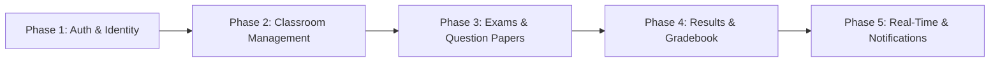

# ClassRoom Backend — Development Tracker

> [!IMPORTANT]
> This document tracks the active development progress, implemented features, technical roadmap, and release milestones for ClassRoom Backend (`ClassRoom-be`).
> **Rule Requirement:** Whenever a new feature or bug fix is completed, this file **must** be updated immediately to reflect the current state of the server.

---

## 1. Project Overview & Tech Stack

| Property | Value |
|---|---|
| **Project Name** | ClassRoom Backend (`ClassRoom-be`) |
| **Runtime** | Node.js + TypeScript (`tsx` / `ts-node`) |
| **Framework** | Express.js v5 |
| **ORM** | Drizzle ORM (`drizzle-orm` v0.45) |
| **Database** | Neon PostgreSQL (`@neondatabase/serverless`) |
| **Cache** | Redis via `ioredis` |
| **Job Queues** | BullMQ (`bullmq`) |
| **Email Service** | Brevo (`@getbrevo/brevo`) |
| **Authentication** | JWT (Access + Refresh Token) + TOTP-based OTP (Email 2FA) |
| **Security** | `helmet`, `cors`, `bcrypt`, `cookie-parser` |
| **Dev Tooling** | `nodemon`, `drizzle-kit`, `tsx`, `typescript` |
| **Frontend Pair** | React 19 + TypeScript (Vite 8) (`ClassRoom-fe`) |

---

## 2. Milestone Roadmap & Current Phase

- [x] **Phase 1 — Authentication & Identity Verification** *(Status: Complete)*
  - Registration, Login, OTP/TOTP Email 2FA, Refresh Token rotation, Logout, role-based JWT middleware.
- [x] **Phase 2 — Classroom Management** *(Status: Complete)*
  - Teacher CRUD for classrooms, student join via code, teacher approval/rejection (individual + bulk), student roster, per-classroom Redis caching, student approval notifications.
- [ ] **Phase 3 — Exams & Question Papers** *(Status: Stub Only — Planned)*
  - Exam creation, question paper builder, scheduled exam slots, exam attempt lifecycle (`IN_PROGRESS → SUBMITTED → ABANDONED`).
- [ ] **Phase 4 — Results & Gradebook** *(Status: Planned)*
  - Attempt answer recording, auto-grading, per-student result reports, gradebook aggregation.
- [ ] **Phase 5 — Real-Time & Push Notifications** *(Status: Planned)*
  - WebSocket events, real-time submission alerts, live status updates.

---

## 3. API Endpoint Matrix

### 3.1. Auth Routes — `/api/auth`

| Method | Endpoint | Auth Required | Role | Status | Controller | Description |
|---|---|---|---|---|---|---|
| `POST` | `/register` | ❌ | Any | `Completed` | `registerUser` | Creates user with hashed password, sends OTP via BullMQ email queue. |
| `POST` | `/login` | ❌ | Any | `Completed` | `loginUser` | Validates credentials, dispatches login OTP email job. |
| `POST` | `/verify` | ❌ | Any | `Completed` | `verifyOTP` | Validates TOTP code, issues access + refresh tokens, marks user verified on signup. |
| `POST` | `/refresh` | ❌ (Cookie) | Any | `Completed` | `refreshTokenHandler` | Rotates access token using HTTP-only `refresh_token` cookie. |
| `POST` | `/logout` | ✅ Bearer | Any | `Completed` | `logoutUser` | Deletes refresh token record, clears cookie. |

### 3.2. Classroom Routes — `/api/classrooms`

| Method | Endpoint | Auth Required | Role | Status | Controller | Description |
|---|---|---|---|---|---|---|
| `POST` | `/` | ✅ | `TEACHER` | `Completed` | `createClassroom` | Creates classroom with collision-resistant 8-char join code; warms Redis cache. |
| `GET` | `/` | ✅ | `TEACHER` | `Completed` | `getClassrooms` | Lists all teacher's classrooms with aggregate `studentCount` and `pendingCount`; warms Redis. |
| `GET` | `/:classroomId` | ✅ | Any | `Completed` | `getClassroomById` | Fetches single classroom with teacher info and enrollment counts. |
| `PUT` | `/:classroomId` | ✅ | `TEACHER` | `Completed` | `updateClassroom` | Updates classroom fields; invalidates Redis cache on change. |
| `GET` | `/:classroomId/students` | ✅ | Any | `Completed` | `getStudentsInClassroom` | Returns approved students, paginated; Redis cache-first strategy. |
| `GET` | `/:classroomId/pending-requests` | ✅ | `TEACHER` | `Completed` | `getPendingRequests` | Lists pending join requests with student details. |
| `POST` | `/join` | ✅ | `STUDENT` | `Completed` | `joinClassroom` | Student joins via join code; creates `PENDING` enrollment record. |
| `PUT` | `/resolve` | ✅ | `TEACHER` | `Completed` | `resolveRequest` | Approves or rejects an individual student join request; invalidates cache. |
| `PUT` | `/bulk-approval` | ✅ | `TEACHER` | `Completed` | `bulkApproval` | Bulk approve or reject all pending requests for a classroom; invalidates cache. |
| `GET` | `/student` | ✅ | `STUDENT` | `Completed` | `getClassRoomsByStudent` | Lists all classrooms for a student (APPROVED + PENDING); Redis cache-aside. |
| `GET` | `/notifications` | ✅ | `STUDENT` | `Completed` | `getStudentNotifications` | Fetches student approval notifications with unread badge count. |
| `PATCH` | `/notifications/:classroomId/read` | ✅ | `STUDENT` | `Completed` | `markNotificationAsRead` | Marks a single classroom notification as read. |
| `PATCH` | `/notifications/read-all` | ✅ | `STUDENT` | `Completed` | `markAllNotificationsAsRead` | Marks all APPROVED classroom notifications as read. |

### 3.3. Exam Routes — `/api/exams`

| Method | Endpoint | Auth Required | Role | Status | Controller | Description |
|---|---|---|---|---|---|---|
| `POST` | `/` | ✅ | Any | `Stub (501)` | `createExam` | Placeholder — exam creation not yet implemented. |
| `POST` | `/:examId/submit` | ✅ | Any | `Stub (501)` | `submitExamAttempt` | Placeholder — exam submission not yet implemented. |
| `GET` | `/:examId/results` | ✅ | Any | `Stub (501)` | `getExamResults` | Placeholder — results fetching not yet implemented. |

### 3.4. User Routes — `/api/users`

| Method | Endpoint | Auth Required | Role | Status | Controller | Description |
|---|---|---|---|---|---|---|
| `PUT` | `/update-personal-info` | ✅ | Any | `Completed` | `updateDetails` | Updates `fullName` and `phoneNumber` for the authenticated user. |
| `DELETE` | `/delete-user` | ✅ | Any | `Completed` | `deleteUser` | Deletes authenticated user record and clears auth cookies. |

---

## 4. Database Schema

All tables defined in `src/database/schema.ts` using Drizzle ORM for Neon PostgreSQL.

### 4.1. Enums

| Enum | Values |
|---|---|
| `user_role` | `TEACHER`, `STUDENT` |
| `join_status` | `PENDING`, `APPROVED`, `REJECTED` |
| `attempt_status` | `IN_PROGRESS`, `SUBMITTED`, `ABANDONED` |

### 4.2. Tables

| Table | Primary Key | Key Columns | Indexes | Notes |
|---|---|---|---|---|
| `users` | `uuid` | `role`, `email`, `userName`, `verified` | unique on `email`, `userName`, `phoneNumber` | `verified: false` on creation; toggled `true` after signup OTP. |
| `subjects` | `uuid` | `name` | unique on `name` | Optional FK on `classrooms.subjectId`. |
| `classrooms` | `uuid` | `teacherId`, `joinCode`, `themeColor`, `isArchived` | `idx_classrooms_teacher` on `teacherId` | Collision-resistant 8-char join code; `themeColor` defaults to `#1d4ed8`. |
| `classroom_students` | Composite `(classroomId, studentId)` | `status`, `isNotificationRead` | `idx_classroom_students_student` on `studentId` | Junction table; explicit student index due to composite PK left-scan behavior. |
| `question_papers` | `uuid` | `teacherId`, `isPublished` | `idx_question_papers_teacher` | Created by teachers; linked to exams. |
| `questions` | `uuid` | `questionPaperId`, `options` (JSONB), `correctAnswer` | `idx_questions_paper` | `options` stored as JSONB; `marksAwarded` defaults to `1.00`. |
| `exams` | `uuid` | `classroomId`, `questionPaperId`, `scheduledStart`, `durationMinutes` | `idx_exams_classroom` | Timed exams linked to classrooms. |
| `exam_attempts` | `uuid` | `examId`, `studentId`, `status`, `totalScore` | `idx_exam_attempts_exam`, `idx_exam_attempts_student` | Unique constraint per `(examId, studentId)` — one attempt per student. |
| `attempt_answers` | `uuid` | `examAttemptId`, `questionId`, `selectedOption`, `isCorrect` | `idx_attempt_answers_question` | Unique per `(examAttemptId, questionId)`; stores `marksObtained` for auto-grading. |
| `refresh_tokens` | `userId` (FK) | `token_hash`, `expiresAt` | — | One refresh token per user; overwritten on each new session. |

---

## 5. Architectural Modules

### 5.1. Infrastructure & Startup (`src/utils/startup.utils.ts`)
- `verifyAndSetupEnv()` — validates all required environment variables before boot.
- `connectAllDb()` — initialises Neon PostgreSQL connection.
- `connectRedis()` / `closeRedisConnection()` — manages `ioredis` connection lifecycle.
- `startAllQueues()` / `startAllWorkers()` — registers BullMQ queues and email worker.
- Graceful shutdown handlers for DB, Redis, and queues on crash/exit.

### 5.2. Authentication (`src/utils/auth.utils.ts`)
- `hashPassword` / `verifyPassword` — bcrypt wrappers.
- `issueTokensAndSetCookie` — creates and persists short-lived access JWT + long-lived `refresh_token` HTTP-only cookie.
- `verifyToken` — validates access or refresh JWTs.
- `verifyAndRefreshSession` — rotates tokens using refresh cookie, used by both `refreshTokenHandler` and silent-refresh inside `authenticateToken` middleware.
- `AuthError` — typed error class for structured HTTP responses.

### 5.3. OTP / TOTP Engine (`src/utils/totp.class.ts`)
- `TimeWindowOTP` — singleton class powered by `otplib` (TOTP standard).
- Server-secret + per-user-ID derived HMAC-SHA256 secret; stateless OTP generation.
- Look-back window configured to tolerate network latency (configurable, capped at ≤5800s epoch tolerance).
- Attempt tracking stored in Redis hash (`TOTP:<userId>`) with max-attempts enforcement.
- Methods: `generateOtp(userId)`, `verifyOtp(userId, token)`.

### 5.4. Redis Caching (`src/redis/redis.api.ts`)
- `putValue` / `getValue` / `containsKey` / `deleteKey` — key-value store with TTL per data type.
- `putHash` / `getHash` — hash store (used by TOTP attempt tracking).
- Keys namespaced via `makeRedisKey(type, id)` (e.g., `CLASSROOM:<id>`, `CLASSROOM_STUDENTS:<id>`, `TOTP:<userId>`).

### 5.5. Email Queue & Worker
- **Queue** (`src/queues/email.queue.ts`): BullMQ queue instance for async email dispatch.
- **Worker** (`src/workers/email.worker.ts`): Processes queued email jobs using Brevo.
- **Service** (`src/notifications/brevoService.ts`): Brevo transactional email API wrapper.
- Templates: `SIGNUP_OTP` and `SIGNIN_OTP`. Jobs deduplicated via `jobId` keyed on `EmailTemplateType + userId`.

### 5.6. Middleware Stack

| Middleware | File | Purpose |
|---|---|---|
| `authenticateToken` | `auth.middleware.ts` | Validates Bearer JWT; silently refreshes on `TokenExpiredError`; hydrates `req.user`. |
| `authorized(role)` | `auth.middleware.ts` | Role-based route guard; returns `403` on role mismatch. |
| `errorHandler` | `error.middleware.ts` | Global Express error handler for unhandled exceptions. |

---

## 6. Infrastructure Configuration

| Service | Tool | Notes |
|---|---|---|
| **Database** | Neon PostgreSQL | Serverless HTTP adapter via `@neondatabase/serverless` |
| **Migrations** | `drizzle-kit generate` + `drizzle-kit migrate` | Config in `drizzle.config.ts` |
| **Cache** | `ioredis` → local/remote Redis | Docker Compose via `docker.yml` |
| **Job Queue** | BullMQ + Redis | Email dispatch (OTP mails) |
| **Email** | Brevo (Sendinblue) | Transactional emails for OTP |
| **Dev Server** | `nodemon --exec tsx index.ts` | Hot-reload TypeScript dev server |

---

## 7. Next Immediate Development Tasks

1. **Implement Exam Module** *(Phase 3)*:
   - `createExam` — associate a `questionPaper` to a `classroom` with `scheduledStart` and `durationMinutes`.
   - `submitExamAttempt` — record all `attemptAnswers`, auto-grade by comparing `selectedOption` vs `correctAnswer`, compute `totalScore`, set `status = SUBMITTED`.
   - `getExamResults` — aggregate per-student score, answer breakdown, and `isCorrect` flags.
2. **Question Paper Builder** *(Phase 3)*:
   - CRUD endpoints for `questionPapers` and `questions` (teacher only).
   - Publish/unpublish flow (`isPublished` flag).
3. **Resend OTP Endpoint**:
   - Add `POST /auth/send-otp` to re-dispatch OTP email (with rate-limiting guard via Redis).
4. **Re-enable Redis Cache for `getClassroomById`**:
   - Cache read is currently commented out; re-enable after verifying stale-data edge cases.
5. **Profile Picture Upload**:
   - `profilePictureUrl` column exists in schema but no upload endpoint is implemented yet.

---

## 8. Changelog

| Date | Author / Agent | Changes Made |
|---|---|---|
| 2026-10-03 | Antigravity | Initialized `development-tracker.md` for `ClassRoom-be`. Evaluated full codebase: auth, classroom, exam stubs, DB schema, Redis caching, BullMQ queue/worker, TOTP engine, and middleware stack. |
